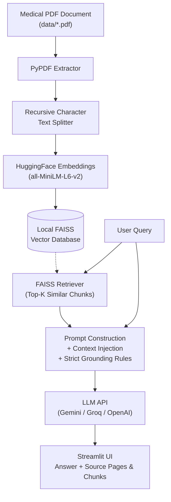

# 🩺 Medical RAG Chatbot

An end-to-end, grounded **Retrieval-Augmented Generation (RAG)** chatbot built completely from scratch using **LangChain**, **PyPDF**, **HuggingFace Sentence-Transformers**, **FAISS**, and **Streamlit**.

Designed specifically for medical question-answering with strict hallucination guardrails and source citation transparency.

---

## 📌 Features

- **Automatic PDF Ingestion**: Inspects the `data/` directory automatically and extracts text using `PyPDF`.
- **Semantic Text Chunking**: Splits large medical reference volumes using recursive character chunking with overlap to preserve clinical context.
- **Local Dense Embeddings**: Generates 384-dimensional dense vector embeddings locally using `sentence-transformers/all-MiniLM-L6-v2`.
- **FAISS Vector Database**: Fast local vector similarity search powered by Meta's FAISS library.
- **Strict Grounded RAG Behavior**:
  - The model **only** answers based on the retrieved reference document.
  - If information is missing, it returns:  
    > *"I could not find sufficient information about this in the provided medical document."*
  - Zero extrapolation or hallucinated medical advice.
- **Source Citation & Traceability**: Each response provides expandable references displaying the exact chunk excerpt, source filename, and page number.
- **Multi-LLM API Support**: Works out of the box with **Google Gemini**, **Groq (Llama 3.3)**, or **OpenAI (GPT-4o mini)**.
- **Student Portfolio-Ready**: Clean modular architecture with separation of concerns (`config`, `ingest`, `retriever`, `llm`, `app`).

---

## 🏗️ System Architecture



---

## 📁 Project Structure

```
medical-rag-chatbot/
│
├── data/
│   └── [medical reference PDF]   # Your local medical PDF
│
├── vectorstore/
│   └── faiss_index/              # Saved local FAISS index files
│
├── src/
│   ├── __init__.py               # Source package initializer
│   ├── config.py                 # Paths, hyper-parameters, prompts & disclaimers
│   ├── ingest.py                 # PDF loading, chunking, embedding & FAISS indexing
│   ├── retriever.py              # FAISS loading and similarity retrieval
│   └── llm.py                    # Multi-provider LLM integration and grounded prompt
│
├── app.py                        # Streamlit web application & chat interface
├── requirements.txt              # Project dependencies
├── .env.example                  # Environment variable template
├── .gitignore                    # Git ignore file
└── README.md                     # Documentation
```

---

## 🚀 Getting Started

### 1. Prerequisites
- Python 3.10+ (tested through Python 3.14)
- A medical PDF placed inside the `data/` directory.

### 2. Install Dependencies
```bash
pip install -r requirements.txt
```

### 3. Configure API Key
Copy `.env.example` to `.env`:
```bash
cp .env.example .env
```
Edit `.env` and insert your API key:
```env
LLM_PROVIDER=google
GOOGLE_API_KEY=your_gemini_api_key_here
```
*(Alternatively, enter your API key directly in the Streamlit UI sidebar).*

---

## ⚡ Running Data Ingestion

You can build the FAISS vector database from your PDF in two ways:

### Option A: From the Command Line
```bash
python src/ingest.py
```
*Note: To index a specific number of pages for rapid testing, pass the page count as an argument (e.g., `python src/ingest.py 50`).*

### Option B: From the Streamlit UI
Click the **"⚡ Generate / Rebuild FAISS Index"** button in the sidebar.

---

## 💻 Running the Streamlit App

Launch the chatbot application:
```bash
python -m streamlit run app.py
```
*(or `streamlit run app.py`)*

Open your browser at `http://localhost:8501`.

---

## ⚠️ Medical Disclaimer

> **This chatbot provides informational content based on the provided reference document and is not a substitute for professional medical advice, diagnosis, or treatment.**
